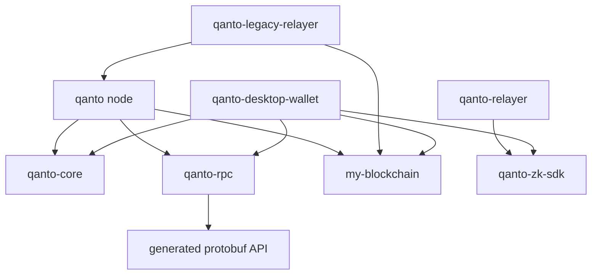
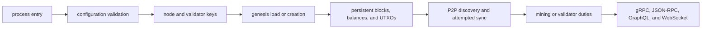
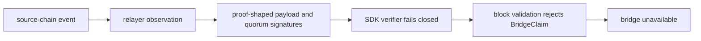

# Qanto Architecture Reconstruction

Status: **FINAL AUDIT RECONSTRUCTION**. This document describes the effective working tree and executed evidence, not marketing claims.

Expanded-mandate verdict: **NOT SAFE FOR PRIVATE TESTNET**

Twelve-workstream verdict: **NOT READY**

## Cargo workspace

| Package | Role in effective tree | Important feature gates |
|---|---|---|
| `qanto` | Main node library and binaries; DAG, validation, networking, APIs, SAGA, persistence, mining orchestration | default `zk`; `real-zk-verifier`; `cuda`; `gpu`; `infinite-strata`; performance/heap test gates |
| `my-blockchain` | Qanhash CPU/GPU code, storage-backed blockchain types, libp2p support | default `zk`; `gpu`; `cuda`; `metrics` |
| `qanto-core` | Shared native crypto, serialization, storage, network, and DAG-aware mempool abstractions | optional legacy PQ crypto |
| `qanto-rpc` | Protobuf-generated gRPC service and server facade | no production feature gate |
| `qanto-zk-sdk` | Bridge witness/proof request construction and fail-closed verification API | empty legacy-compatibility feature |
| `qanto-relayer` | New port/adapter-based EVM-to-Qanto relayer | no feature gates |
| `qanto-legacy-relayer` | Older standalone relayer depending directly on the node crate | analyzer-only dummy gate |
| `qanto-desktop-wallet` | Tauri wallet, keystore, signing, and RPC client | default legacy Dilithium integration |

## Non-Cargo runtime surfaces

- `SmartContracts/`: Hardhat workspace with ten contracts, deployment scripts, and one consolidated test file.
- `DevOps/docker/`: current Docker and compose assets; root Docker assets and `hf_bootnode/` are deleted in the candidate tree.
- `DevOps/k8s/` and `DevOps/helm/`: orchestration assets inspected statically; deployment against actual node configuration and health endpoints was not runtime-validated.
- `grafana/`: Prometheus configuration and a Qanto testnet dashboard.
- `Frontend/`, `sdk/`, and desktop packages: user/developer surfaces outside the consensus core but relevant to release claims and attack surface.

## Dependency direction

The graph confirms two architectural risks: the legacy relayer imports the entire node, and the workspace carries two independently evolving relayer implementations.

## Main-node module surface

`Protocol_Core/qanto-node/src/lib.rs` publicly resolves 112 module declarations. It explicitly labels a large group as “Added unreferenced modules”; those modules are not evidence of a wired production capability. The generated lexical graph classifies modules into:

1. reachable from a production binary or public API;
2. reachable only under a feature gate;
3. test/benchmark-only;
4. declared but otherwise unreferenced;
5. stub, mock, simulation, or placeholder.

The completed graph resolves every declared source, identifies 38 lexical-isolation candidates, 33 modules containing stub/mock markers, and two multi-module strongly connected components. These are triage signals, not compiler-semantic dead-code proof. Exact members and generator limitations are recorded in `MODULE_GRAPH.md`, `module-graph.json`, and `module-graph.dot`.

## Critical flows and their proven failure boundaries

### Node startup

Confirmed boundaries:

- the shipped testnet genesis loads the full 21 billion QNTO into balances/UTXOs, while the emission counter initializes at zero and is not restored from state;
- canonical block validation does not enforce one canonical genesis/root;
- startup `RequestState` broadcasts the requesting node's own state rather than obtaining an authenticated peer checkpoint, and the protobuf state-request path is unsupported;
- the release profile uses `panic = "abort"`, while the state path lacks an atomic database batch/undo journal and mutates live UTXOs before later fallible operations;
- API-before-sync ordering and crash-consistent shutdown flushing were not established by an end-to-end deployment test, so neither is credited as safe.

### Transaction and block path

```mermaid
flowchart LR
    Client["client or API"] --> Parse["decode and structural limits"]
    Parse --> Auth["signature and identity checks"]
    Auth --> State["UTXO, replay, and fee checks"]
    State --> Pool["mempool admission and gossip"]
    Pool --> Candidate["candidate selection"]
    Candidate --> Proof["QanHash and block production"]
    Proof --> Validate["is_valid_block consensus gate"]
    Validate --> Commit["live UTXO mutation then persistence enqueue"]
    Commit --> Choice["DAG fork choice queried separately"]
    Choice --> Finality["automatic finality disabled"]
```

Final assessment:

- inbound block IDs are recomputed, fixed difficulty is enforced, and block reward equality now requires SAGA base reward plus fees with exact coinbase totals;
- native transaction signatures are not bound to `sender`, and block signatures are not bound to the validator identity/eligibility record;
- the block ID/signature omits accepted consensus fields, including nonce, reward, effort, cross-chain and other metadata;
- the SAGA reward and dynamic block-size checks depend on node-local mutable/floating state, so honest nodes can disagree on the same block;
- fork-choice tie ordering is deterministic for the same well-formed block set, but duplicate parents amplify weight and noncanonical roots remain admissible;
- every accepted branch mutates one global state in arrival order; there is no branch-scoped state, atomic apply/unapply, or reorg rollback;
- there is no active production finality protocol or finality horizon.

### Interoperability path

No real source-chain light client or sound bridge proof verifier exists. The underlying claim handler is not safe to authorize minting, but the effective node and SDK now fail closed. That is a security containment, not working interoperability.

## Consensus, state, and finality architecture

| Layer | Effective implementation | Safety conclusion |
|---|---|---|
| Block production | Fixed-difficulty QanHash plus candidate construction using local SAGA and chain-load state | Producer output is not based solely on committed deterministic state |
| Canonical validation | `QantoDAG::add_block` calls `QantoDAG::is_valid_block`; the separate `Consensus::validate_block` is not the production gate | PoW is active; canonical DPoS selection, PoSe, and quorum finality are not enforced |
| Block commitment | Recomputed ID, Merkle root, embedded-key signature, fixed difficulty | Validator identity is unbound and multiple accepted fields are outside the authenticated commitment |
| Fork choice | Difficulty-based descendant weight with lexical root/child ties | Pure selection is deterministic under well-formed inputs; duplicate parents and multiple roots violate the assumptions |
| State transition | One shared UTXO/balance state is validated and mutated for every accepted DAG branch | Arrival-dependent and non-atomic; no canonical reorg apply/unapply |
| Persistence | Live state mutation precedes asynchronous persistence enqueue and block insertion | Later errors can leave partial state; no atomic write batch/undo journal was found |
| Finality | Unsafe periodic invocation disabled; dormant depth/stake helper remains callable | No active certificate, no safe horizon, and no production irreversibility guarantee |

## Network and resource-isolation architecture

| Surface | Effective architecture | Residual risk |
|---|---|---|
| Discovery | Static/cached seeds plus Kademlia DHT bootstrap and closest-peer queries; no canonical mDNS behavior is wired | No enforced IP/subnet/ASN diversity or peer rotation; eclipse resistance is not demonstrated |
| Session identity | Compound `(PeerId, ConnectionId)` session key | Closing one connection removes explicit-peer status even if another remains |
| Reconnection | Backoff can sleep inside the swarm event loop for up to five minutes | A disconnect can stall unrelated swarm work; partition recovery is not live-tested |
| Propagation | Consensus accepts up to 32 MiB, gossip approximately 2 MB, QDS 4 MiB | A valid local block or snapshot can be impossible to propagate |
| Sync | Startup command sends local state; authenticated resumable checkpoint protocol absent | New-node bootstrap and partition recovery are not production-capable |
| APIs | gRPC/JSON-RPC/GraphQL/WebSocket share the node's state and process resources | End-to-end authentication, rate-isolation, bulkhead, and remote-exhaustion evidence is incomplete |

## SAGA and adaptive-control placement

SAGA's active attack classification is heuristic. A custom neural/training scaffold exists, but no production inference call, populated training buffer, authenticated model artifact, or model-activation protocol was found. OMEGA is a process-local, random/time/action-order heuristic. Both remain unsafe as consensus inputs because SAGA's required reward consumes local floating state and OMEGA's local threat flag. Carbon credentials use a predictable string rather than a cryptographic issuer signature and feed the same reward path. Automatic slashing and dynamic sharding were disabled as containment.

## Deployment and operational topology

Dedicated Docker/VPS-oriented assets exist, but the Kubernetes/Helm, bootstrap, monitoring, secrets, backup/restore, and disaster-recovery paths were not reproducibly proven on a fresh Ubuntu 22.04 host. Legacy Hugging Face deployment material remains structurally unsuitable for a public P2P blockchain. Grafana configuration does not consistently map to metrics actually exported by the node. Runtime validation with Docker, Helm, kubectl, ShellCheck, and Terraform was unavailable in this environment.

## Architecture facts already confirmed

- The release profile enables fat LTO, one codegen unit, stripping, `opt-level = 3`, and `panic = "abort"`.
- The default node build enables `zk`; a non-`zk` build substitutes `zkp_stub.rs` under the same public module name.
- A separate `real-zk-verifier` feature exists and must not be confused with the default `zk` feature.
- The root manifest now retains three provisional local crates.io patches: `ark-relations`, `libp2p-dns`, and `libp2p-mdns`. The derivative, top-level tracing-subscriber, and plist overrides were removed; one tracing Git copy remains through the patched Arkworks stack.
- The default workspace compiles, but all-targets cannot compile because `mining_bench.rs` targets missing/obsolete APIs.
- The no-default node profile and CUDA mining profile do not compile.
- CPU, OpenCL, CUDA, and Metal QanHash implementations are algorithmically different; heterogeneous proof output is therefore not consensus-safe.
- The sealed 21B/80%-15%-5% constants are internally consistent and unchanged, but the live SAGA reward/counter/genesis path does not enforce them as a ledger invariant.

## Final verification snapshot

| Evidence | Result |
|---|---|
| Default Cargo workspace | PASS |
| Rust Nextest, zero retries | 207/207 runnable tests pass across 31 binaries; 1 skipped |
| Hardhat | 10 sources compile; 38/38 tests pass |
| Solidity coverage | 42.45% lines / 43.36% statements; critical paths untested |
| Cargo audit | 0 non-ignored known vulnerabilities; strict mode rejects 5 maintenance/yank warnings |
| Cargo deny | Advisories and licenses FAIL; bans and sources PASS |
| All-target / no-default / CUDA | FAIL with 5 / 44 / 5 errors respectively |
| Strict Clippy / full rustfmt | FAIL |

## Evidence gaps that remain gates

- No two-node permutation test proves identical accepted block sets, canonical path, state root, balances, and finality across branch arrival orders.
- No authenticated checkpoint/snapshot, malicious-peer, disconnect/resume, or live partition-recovery harness exists.
- No CPU/OpenCL/CUDA/Metal known-answer parity suite exists; `my-blockchain` lists zero tests.
- No atomic failure-injection and reorg apply/unapply proof exists for state storage.
- No real Solidity SAST, invariant/fuzz, deployment smoke, infrastructure runtime, backup-restore, or sustained soak/chaos evidence was produced.
- No independent cryptographic, economic, consensus, or mainnet-readiness review has closed the open SEV-1/SEV-2 findings.

## Final architecture decision

The effective tree is a large research/prototype system with meaningful containment work, but it is not a convergent production protocol. Passing unit suites do not compensate for unbound authorization, consensus-visible local state, arrival-dependent non-atomic ledger state, absent finality/sync, divergent mining backends, and a broken release feature matrix.

- **NOT SAFE FOR PRIVATE TESTNET** under the expanded mandate.
- **NOT READY** under the twelve mandatory workstreams.
