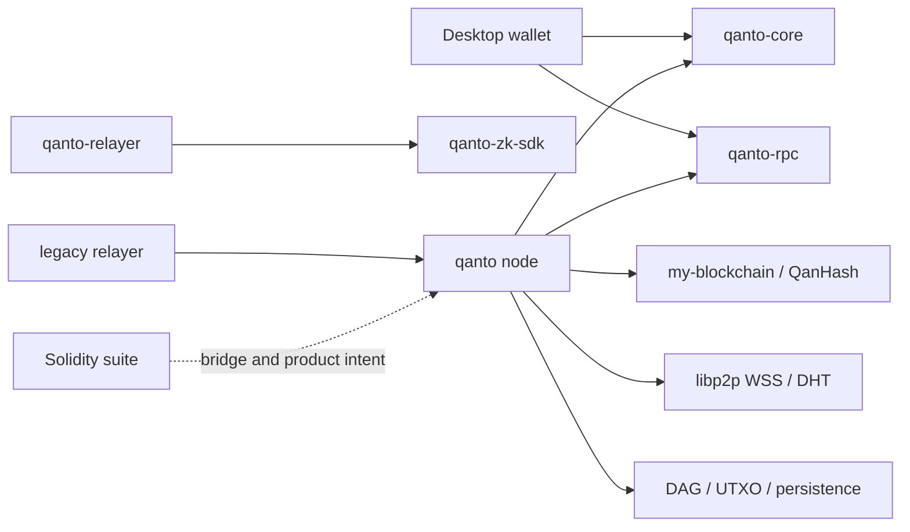

# Qanto master A-to-Z engineering and readiness report

Audit period: 2026-08-08; final reconciliation 2026-08-09  
Target: effective working tree at `/Users/cps/qanto`  
Baseline commit: `0478b60368df86ece44b9ad30766a724dfc60d50` on `main`  
Decision owner: Qanto project leadership; this review does not silently approve protocol changes  
Expanded-mandate verdict: **NOT SAFE FOR PRIVATE TESTNET**  
Twelve-workstream verdict: **NOT READY**

## A. Executive summary

Qanto is a substantial research codebase, not a production-ready blockchain. The effective tree contains real Rust networking, persistence, ML-DSA signing, fixed-difficulty PoW validation, a multi-parent DAG, wallets, RPC surfaces, contracts, and deployment assets. It also contains launch-blocking authorization, consensus, state, hashing, finality, synchronization, economics, bridge, contract, and operations defects.

The audit catalog contains **155 mandatory-workstream finding rows**: 40 SEV-1, 69 SEV-2, 24 SEV-3, and 22 INFO. Some rows describe the same architecture defect from different workstreams, so this is a catalog count rather than 155 independent root causes.

The five most important conclusions are:

1. A transaction's self-supplied ML-DSA key is not bound to its claimed sender, and a block signer is not bound to its claimed validator. That breaks native authorization even though the signature primitive itself is real.
2. Competing branches mutate one global UTXO state in arrival order, with no branch state, apply/unapply journal, or atomic block transaction. Honest nodes can diverge, and a failed block commit can leave partial state.
3. Consensus-visible reward and block-size decisions depend on process-local state and floating arithmetic. The standalone integer emission engine is not the live rule; the shipped genesis already allocates 21B while the emission counter starts at zero.
4. The custom hash has a trailing-zero collision, CPU/GPU mining implementations are not equivalent, active finality is disabled, and startup state synchronization is not a valid request/response protocol.
5. Bridge claims, dynamic sharding, unsafe slashing, and incomplete AMM paths have been contained or disabled. Containment prevents some immediate exploitation; it does not turn the missing feature into a working protocol.

The internal CertiK-style score files currently recompute to 5.0/5.0 and pass their own acceptance gate. Those files are untracked, self-reported inputs that assign 5.0 to every component. They conflict with reproduced defects and therefore are **not independent readiness evidence**. This report's evidence-based score is 20/100 overall.

### Safe changes implemented in the effective tree

- recompute inbound block IDs and reject noncanonical fixed difficulty before expensive validation;
- enforce exact SAGA-base-plus-fee reward equality and exact coinbase distribution;
- stop unbound validator-name slashing, automatic unsafe finality, and nondeterministic dynamic sharding;
- remove unsigned effort from fork weight and add deterministic lexical tie-breaking;
- reject inputless peer/mempool transactions and bridge claims while no real verifier exists;
- discard peer-supplied live UTXOs during synchronization containment;
- make unsupported PQ verification fail closed and decode CPU DAG words explicitly as little-endian;
- update vulnerable dependency versions, remove three unnecessary source overrides, and add a cargo-deny policy;
- repair async Prometheus export and exclude secrets/state from Docker build context;
- contain incomplete QantoSwap entry points, harden WQNTO/QUSD/TGE/Drop/NFT primitives, and add a coherent Hardhat 3 suite;
- rewrite WQNTO deployment to use compiler artifacts, require environment-injected authority, validate chain 1234 and nine decimals, and wait for confirmations;
- remove implicit root `.env` loading from Hardhat, fail-close draft CEX metadata, and correct misleading launch/bridge/airdrop/security documentation.

### Workstream annex map

| Workstreams | Complete findings, fixes, and deferrals |
|---|---|
| 1 and 11 | [DEPENDENCY_AUDIT_AND_TESTING.md](DEPENDENCY_AUDIT_AND_TESTING.md) |
| 2, 5, 6, and 7 | [CONSENSUS_NETWORK_TRANSACTION_SAGA.md](CONSENSUS_NETWORK_TRANSACTION_SAGA.md) |
| 3 and 4 | [PQC_AND_TOKENOMICS.md](PQC_AND_TOKENOMICS.md) |
| 8, 9, and 10 | [CONTRACTS_PERFORMANCE_OPERATIONS.md](CONTRACTS_PERFORMANCE_OPERATIONS.md) |
| 12 | [SPECIFICATION_DELTA.md](SPECIFICATION_DELTA.md) |
| Byte-exact implemented-fix evidence | [IMPLEMENTED_FIXES_EFFECTIVE.diff](IMPLEMENTED_FIXES_EFFECTIVE.diff) |
| Approval-gated protocol changes | [PROTOCOL_CHANGE_PROPOSALS.md](PROTOCOL_CHANGE_PROPOSALS.md) |
| P0/P1/P2 execution plan | [REMEDIATION_ROADMAP.md](REMEDIATION_ROADMAP.md) |
| Public-testnet and mainnet gates | [MAINNET_READINESS.md](MAINNET_READINESS.md) |

### Mandatory workstream verdicts

| Workstream | Verdict | Principal unresolved gates |
|---|---|---|
| §1 Codebase/dependencies | **NOT READY** | `WS1-002`–`WS1-004`: unsound/unmaintained dependency and first-party licensing gates |
| §2 Consensus | **NOT READY** | `CNS-001`, `CNS-003`, `CNS-005`–`CNS-010`: identity, deterministic rules, commitments, branch state, atomicity, finality |
| §3 Cryptography/PQC/ZK | **NOT READY** | `PQC-001`, `PQC-002`, `CRY-002`, `POW-001`, `POW-002`: identity, hash, and backend consensus defects; bridge unavailable |
| §4 Tokenomics/emission | **NOT READY** | `ECO-003`–`ECO-007`: live reward, ledger cap, fee issuance, restart/genesis, community budget |
| §5 Networking/P2P | **NOT READY** | `NET-003`–`NET-009`: sync, propagation, snapshot trust, reconnect, eclipse, encoding, authentication |
| §6 Transaction/mempool/UTXO | **NOT READY** | sender binding, global fork state, non-atomic application, dormant unsafe elite path |
| §7 SAGA/ΩMEGA/green mining | **NOT READY** | local/floating consensus inputs, heuristic-not-ML behavior, simulated credentials/scoring, unsafe penalty design |
| §8 Smart contracts | **NOT READY** | `SC-001`–`SC-004`, `SC-006`–`SC-009`: absent peg/AMM/vesting/governance and synthetic deployment paths |
| §9 Performance/scalability | **NOT READY** | `PERF-001`–`PERF-009`: synthetic claims, failing benchmark, latent unsafe optimizers, absent sharding, durability evidence |
| §10 DevOps/deployment | **NOT READY** | `OPS-001`–`OPS-011`: broken launch/manifests/edge/monitoring/restore and incomplete HF-to-VPS migration |
| §11 Testing/formal verification | **NOT READY** | `WS11-001`–`WS11-004`: mining parity, canonical-state/reorg, real partition/sync, and contract assurance gaps |
| §12 Documentation/specification | **NOT READY** | `SPEC-002`–`SPEC-011`: OVERVIEW and legacy metadata conflict with active protocol and measured evidence |

Each annex contains the required findings table, implemented-fix evidence, deferred items with effort/priority, and workstream-specific conclusions. This compact table makes the final decision explicit for all twelve sections.

## B. Repository baseline

The audit began from a materially dirty working tree. Existing tracked and untracked work was preserved; no commit, reset, clean, or destructive operation was performed. Findings describe the effective candidate tree, not a pristine baseline checkout.

| Evidence | Before | After/current |
|---|---|---|
| Default Rust build | Workspace check passed | `cargo check --workspace --locked` passes |
| All-target Rust build | Five stale benchmark API errors | Still fails on the untracked `mining_bench.rs`; not hidden |
| No-default node build | Not a release gate | Fails with 44 feature-gating errors |
| CUDA feature | Not established | Fails: missing `cudarc`, `Arc`, and `get_qdag`; backend also differs algorithmically |
| Rust tests | 202 run: 201 passed, 1 failed, 1 skipped | Two successive zero-retry runs passed 207/207 with 1 skipped across 31 binaries (13.346s then 13.458s) |
| Solidity tests | Incoherent/deprecated plugin stack | Ten sources compile with solc 0.8.24; **38/38 pass** |
| Solidity coverage | Not measured | 42.45% lines, 43.36% statements; four contracts at 0% |
| RustSec | `crossbeam-epoch 0.9.18` vulnerable plus warnings | Zero **non-ignored** known vulnerabilities under cargo-audit policy; five maintenance/yank warnings remain and strict cargo-deny is red |
| cargo-deny | No canonical policy/tool result | Bans/sources pass; advisories and licenses fail |
| Formatting | Dirty tree not rustfmt-clean | Still fails broadly; touched-file diff check passes |
| Strict Clippy | Not green | Fails on current warnings before reaching stale benchmark errors |

Tooling unavailable in this environment included Slither, Mythril, Foundry/Echidna, Miri, Docker, Helm, kubectl, ShellCheck, and Terraform. Their absence is reported as an evidence gap, never as a pass.

## C. Architecture map

The Cargo workspace resolves eight members: the main `qanto` node, `qanto-core`, `qanto-rpc`, `my-blockchain`, `qanto-zk-sdk`, `qanto-relayer`, the legacy relayer tool, and the Tauri desktop wallet. The non-Cargo surfaces include ten Solidity contracts, frontend/SDK trees, Docker/Kubernetes/Helm assets, and Grafana/Prometheus configuration.

The lexical module graph resolves 112 declarations, identifies 38 isolation candidates, 33 modules with stub/mock/placeholder markers, and two large strongly connected components. It is recorded in [MODULE_GRAPH.md](MODULE_GRAPH.md), [module-graph.dot](module-graph.dot), and [module-graph.json](module-graph.json). A declaration is not evidence that a feature is wired into production.

## D. Trust model

The effective protocol currently trusts too much self-asserted data:

| Boundary | Required trust | Current failure |
|---|---|---|
| Transaction to UTXO | signer key must derive/bind sender and every input owner | self-supplied valid key authenticates the claimed sender string |
| Block to validator | signer must bind registered, eligible validator | self-supplied block key authenticates the declared validator string |
| Block to consensus | every consensus field must be committed and deterministic | multiple accepted fields are outside ID/signature; reward/size depend on local state |
| Branch to state | state must be derived from a canonical parent and atomically committed | every accepted fork mutates one global state before canonical choice |
| Finality to client | signed quorum certificate over an exact state/block | active finality is disabled; dormant logic is not a safe certificate |
| Peer to sync | authenticated checkpoint, bounded chunks, root verification | request path is nonfunctional; supplied UTXOs are now discarded |
| Source chain to bridge | finalized header, inclusion proof, event binding, nullifier | real verifier absent; claims correctly fail closed |
| Operator to deployment | immutable release, distinct identities/storage, secret manager, TLS edge | checked-in launch paths are inconsistent and unrehearsed |

## E. Threat model

Highest-value assets are supply/UTXO integrity, deterministic history, validator and wallet keys, bridge authenticity, genesis/state integrity, node availability, governance/treasury authority, and recoverability. Relevant attackers include malicious users, validators, miners, peers, Sybil swarms, relayers, API clients, compromised operators, dependency attackers, snapshot providers, and cloud outages.

The most credible current attack chains are:

1. claim a victim sender or validator string while signing with an attacker-controlled PQ key;
2. exploit arrival-dependent competing spends or partial commit failure to diverge state;
3. mutate or exploit uncommitted block fields and duplicate parents;
4. split honest validation through local SAGA reward/block-size inputs;
5. isolate/stall a node through weak peer diversity, blocking reconnect, or broken sync;
6. cause nonportable mining results through hash/backend divergence;
7. mislead users through synthetic deployment scripts, incomplete contracts, or legacy endpoints.

The detailed adversary/asset matrix is in [THREAT_MODEL.md](THREAT_MODEL.md).

## F. Consensus safety

`QantoDAG::is_valid_block` is the canonical gate; the separate `Consensus::validate_block` path is not the production authority. The exact ordered check trace is in the consensus annex.

Positive controls now include ID recomputation, exact fixed difficulty, PoW checking, future-time bounds, parent existence/height checks, Merkle verification, coinbase position/signature/distribution checks, transaction signature/UTXO checks, and intra-block duplicate-input rejection.

Safety remains unproven because validator identity is unbound, the authenticated block domain is incomplete, roots/duplicate parents are underconstrained, block size and reward are node-local, canonical state is arrival-dependent, and commit is non-atomic. The known SAGA reward equality bypass is fixed; the reward source itself is still unsafe.

## G. Consensus liveness

There is no complete liveness argument. Automatic finality is disabled, new-node synchronization does not request and verify remote canonical state, transport limits disagree, reconnect sleeps can stop swarm polling, and only weak peer diversity is enforced. Under partition or churn, honest recovery to a single state root has not been demonstrated.

## H. Determinism

Pure fork-choice ordering improved: unsigned effort no longer supplies weight, ready queues are ordered, and equal-weight choices use lexical IDs. Six focused determinism tests pass. That proof is conditional on a well-formed identical block set. Nodes are not guaranteed to obtain or accept that set because duplicate parents amplify work, noncanonical roots are accepted, local SAGA/size inputs differ, and global UTXO mutation depends on arrival order.

## I. Mining, proof, and difficulty

Inbound blocks must now declare the fixed network difficulty and satisfy PoW. However:

- `qanto_hash` treats trailing zero bytes as equivalent for some inputs;
- CPU, OpenCL, CUDA, and Metal implement different mixers/finalizers/epoch handling;
- CUDA does not compile in the current feature matrix;
- `my-blockchain` has no executable parity test corpus;
- ASIC-resistance and heterogeneous consensus equivalence are not established.

The only safe path is QIP-002: a versioned, byte-exact hash/mining specification, domain separation/padding, activation rules, and golden vectors across platforms. Do not silently replace a consensus hash.

## J. SAGA architecture

SAGA contains telemetry, heuristics, edicts, and a custom neural implementation. Production neural inference/training is largely unwired; active attack classification is heuristic. Local floating reward inputs, ΩMEGA state, maintenance cadence, UUID edicts, and forgeable carbon credentials influence or can influence consensus-visible decisions. SAGA must remain advisory until a deterministic, integer, epoch-committed protocol is separately approved. “AI-governed” and “green mining verified” are not responsible current claims.

## K. PQC and cryptographic security

The default native signing path performs real ML-DSA sign/verify operations, and the internal Groth16 code calls real Arkworks verification. That does not provide end-to-end PQ security:

- ML-DSA keys are not bound to sender/validator identities;
- ML-KEM material exists but no production key exchange/session was found;
- transport identity remains classical libp2p/Noise assumptions;
- legacy PQClean-family dependencies are unmaintained;
- no NIST KAT/ACVP corpus or independent constant-time review was completed;
- custom hashes and pseudo-P256 code remain unsafe/nonstandard;
- bridge verification is intentionally unavailable.

The standards baseline is NIST [FIPS 203 (ML-KEM)](https://csrc.nist.gov/pubs/fips/203/final), [FIPS 204 (ML-DSA)](https://csrc.nist.gov/pubs/fips/204/final), and [FIPS 205 (SLH-DSA)](https://csrc.nist.gov/pubs/fips/205/final). Algorithm presence is not compliance or certification.

## L. Crypto-agility roadmap

Crypto agility requires versioned address/key/signature suites, domain-separated encodings, explicit activation/retirement epochs, dual-validation migration windows, hardware/wallet/RPC/indexer coordination, and rollback rules. Current feature flags are build switches, not an on-chain migration protocol. QIP-001 and QIP-002 define the approval boundary and test corpus.

## M. Transaction pipeline

The transaction path parses string-encoded `u128` monetary fields, verifies embedded signatures, checks UTXO references, and now rejects inputless mempool submissions. It still does not prove that the embedded PQ key owns `sender`. Mempool conflict/cap checks are check-then-act under concurrency, stale heap entries accumulate, and the dormant elite path accepts weakly validated transactions. A single canonical authorization function and atomic reservation index are required.

## N. P2P security

The server uses static/cached seeds, Kademlia, DNS, WSS, Noise, Yamux, and compound `(PeerId, ConnectionId)` session keys. The known overwrite bug is fixed. Residual defects include one-connection explicit-peer removal, blocking reconnect sleep, weak connection/diversity policy, a public fallback HMAC secret, signer-to-peer identity gaps, lossy protobuf consensus integers, and inconsistent payload limits. Eclipse resistance and partition recovery are not demonstrated.

## O. RPC, GraphQL, and WebSocket security

The APIs expose useful balance/history/submission/telemetry surfaces, but deployment exposes HTTP/gRPC without the intended TLS boundary, automatic finality is absent while RPC carries an `is_finalized` field, and evidence for method-level authentication, consistent request limits, rate isolation, and consensus/API bulkheads is incomplete. The async metrics panic path was fixed. Public RPC must remain behind a hardened, measured edge until the extended surface findings and PTG gates close.

## P. Layer-0 and interoperability

The relayer, bridge witness types, quorum signatures, and experimental proof code exist. The prior synthetic verifier no longer authorizes claims; both SDK and node fail closed. A real bridge still needs source-client finality, canonical receipt/log inclusion, chain/token/amount/recipient binding, stable verification keys/CRS, nullifiers, replay persistence, reorganization policy, proof-parser fuzzing, and an independent bridge audit. Current status: **bridge unavailable**.

## Q. Database and storage

WAL/checkpoint/corruption tests exist and pass. Those tests do not prove the live block path atomic: UTXOs, indexes, persistence queues, block insertion, supply, and validator data do not commit as one transaction. `panic = "abort"` skips destructors and graceful queue drain. The experimental mmap optimizer truncates on open and is not a safe persistence layer. StateV2 needs parent-rooted immutable state, atomic batches, undo/replay, crash injection, and clean-host restore comparison.

## R. State-growth model

No credible five-year state-growth result exists. The code and documentation do not provide measured bytes per accepted transfer, per UTXO, per index entry, per block, compaction amplification, pruning horizon, archival policy, snapshot overhead, or cross-chain message. Therefore state rent, storage bonds, and pruning cannot be responsibly tuned. The correct next artifact is a workload-by-workload byte ledger and 1x/10x/100x/1000x storage/bandwidth model.

## S. Performance and benchmarks

The configured 312,500 transactions at 32 blocks/s arithmetically equals 10M TPS only at roughly 107 encoded bytes per transaction. The benchmark harness defaults to 250 bytes, producing a theoretical payload-only upper bound of about 4.295M TPS before headers, signatures, state, storage, network, or consensus. This is not an attainable measurement. The available realistic benchmark exits with `QuantumSignature(SigningError)`. Synthetic harnesses count requested work or sleep rather than prove accepted durable transactions.

Measured application-level results are limited to test execution and contract coverage. No measured sustained simple-transfer, state-changing, Layer-0 routing, or realistic WAN TPS is available.

## T. Realistic throughput

Current answer: **unknown**. A valid result must report offered, parsed, signature-valid, state-valid, accepted, persisted, propagated, and finalized rates separately; p50/p95/p99 latency; bytes/s; CPU/RAM/disk/network; error/retry/drop rates; validator count; topology; hardware; and raw artifacts. Until then, the responsible public claim is “throughput target under research.”

## U. Decentralization

Defaults target only four mesh peers/two outbound peers, one peer is enough for mesh health, and no IP-prefix/ASN diversity or anchor policy was found. A fixed 128-thread pool can oversubscribe the documented 8–16-vCPU host, while unbounded queues and unmodeled storage/bandwidth threaten small operators. Dedicated VPS/Docker intent is better than the legacy Hugging Face design, but a provider-diverse, small-validator hardware envelope has not been proven.

## V. Supply and emission verification

The sealed constants are internally correct and unchanged:

- scale: 1,000,000,000 atomic units;
- max: 21B QNTO;
- allocations: 16.8B community, 3.15B ecosystem/development, 1.05B liquidity;
- compile-time allocation sum equals max.

The intended integer recurrence is deterministic. The live rule is not that recurrence. The live path uses mutable floating SAGA state, counts fees inside `block.reward` and then as issuance, silently clamps only an internal counter, resets that counter at restart, and does not include the full-supply genesis allocation.

Under the standalone intended recurrence and a one-second aggregate block stream, derived gross miner emission is approximately 15.494B QNTO at 10 years, 71.960B at 50, 131.591B at 100, and 355.872B at 500 before a valid cap. The community allocation is crossed around 2035 under those assumptions and the 21B cap around 2038. Under the shipped full-21B genesis, correct remaining issuable supply is zero. The protocol must choose and approve one coherent genesis/emission design.

## W. Fair-launch verification

Fair launch is not proven. The shipped genesis allocates the full 21B to one address, while documentation also describes mining/community emission and reserved allocations. No independently reproducible allocation manifest, insider-access analysis, mining-hardware parity, launch-time network access proof, or governance of reserved funds closes the gap. Early miners could capture disproportionate issuance under a fast one-second/50-QNTO path if genesis were changed to permit it. QIP-003 requires an explicit decision, not a silent patch.

## X. Reconstructed tokenomics

Economically legitimate QNTO functions could include consensus security, resource/transaction fees, staking or collateral, Layer-0 message fees, and governance deposits. Utility must follow working protocol services; it cannot be manufactured by labels.

No new monetary policy was implemented. The recommended design process is:

1. choose one genesis/allocation/emission ledger in atomic units;
2. separate subsidy from recycled fees and enforce the cap in the atomic state transition;
3. specify validator/miner work and reward distribution;
4. price CPU, bandwidth, state growth, and cross-chain verification independently;
5. specify treasury inflow and governance with transparent limits;
6. simulate bootstrap, adverse-price, low-use, congestion, and long-run security cases;
7. activate only through an approved versioned migration.

## Y. Fee market

Rich gas/SAGA fee calculators exist, but canonical validation enforces only minimum declarations and does not recompute the documented model. No proven state rent, storage bond, congestion auction, burn, treasury share, or cross-chain proof fee exists. Current low-fee claims may simply externalize CPU/bandwidth/storage costs to operators. Until resource measurement and spam simulations exist, cheap fees are an unverified subsidy, not proven efficiency.

## Z. Validator and miner economics

The required per-operator model is:

`net revenue = issuance share + transaction fees + priority fees + interoperability fees - compute - electricity - bandwidth - storage - operations - stake opportunity cost`.

Most inputs are undefined or unsafe, so profitability cannot be calculated honestly. The scenario matrix is intentionally non-numeric where inputs are absent:

| Scenario | Usage/value | Security funding | Current conclusion |
|---|---|---|---|
| Bootstrap | low users, fees, token value | almost entirely issuance or external subsidy | issuance rule is incoherent; viable validator count unknown |
| Early mainnet | growing transfers | issuance plus measured fees | fee capture and hardware costs not measured |
| Large ecosystem | many chains/messages | resource and interoperability fees | bridge/routing services unavailable |
| Global scale | very high traffic | high fees/service revenue needed | state, bandwidth, consensus, and decentralization architecture unproven |

Stress cases of token price -90%/-50%/+100%/+500%, usage -90%/10x/100x, and bandwidth/hardware cost 2x cannot produce dollar outputs until baseline price, fee, workload, allocation, and operator-cost inputs are approved. Formulas and unknowns are preserved instead of invented revenue.

## AA. Protocol treasury

No canonical treasury inflow, fee share, budget, runway, multisig/timelock, spending mandate, audit process, or emergency authority is proven. Reserved allocation constants do not identify custody or governance. Treasury sustainability score is therefore zero. A protocol treasury must be transparent, separate from the founding organization, capped by approved rules, and governed without a unilateral superuser.

## AB. Qanto organization business model

Legitimate revenue does not require hidden token extraction. Viable future services include managed validators, dedicated RPC, enterprise nodes/gateways, indexing, monitoring, integration engineering, support, and SLA-backed infrastructure. Those are hypotheses until a reliable network exists. The root repository is currently MIT-licensed while the mandate says GPL-3.0 is intended. License provenance and any dual/commercial model require qualified legal review before changing package metadata or promising GPL-based economics.

## AC. Governance

The Solidity Governor has a zero proposal threshold, a one-block delay, period math inconsistent with the comment, and no demonstrated compatible IVotes token/deployment lifecycle. SAGA edicts are local rather than quorum-approved. Governance capture resistance, delegation concentration, emergency powers, upgrade boundaries, treasury authority, and MEV policy are not specified end-to-end. Governance must not activate consensus or monetary changes without versioned proposals, quorum evidence, timelock, and rollback/halt policy.

## AD. Dependency and supply chain

Three unnecessary overrides (`derivative`, `tracing-subscriber`, `plist`) were removed. Local `ark-relations`, `libp2p-dns`, and `libp2p-mdns` patches remain for concrete API/hickory compatibility and should be upstreamed or retired during upgrades.

Current `cargo audit` reports zero **non-ignored** known vulnerabilities and five allowed warnings under its configured policy. Strict cargo-deny still blocks on unmaintained `bincode`, unsound `glib 0.18.5`, unmaintained PQClean-family crates, yanked `num-bigint`/`spin`, and four first-party crates without declared licenses. Relevant primary advisories include [RUSTSEC-2024-0429](https://rustsec.org/advisories/RUSTSEC-2024-0429), [RUSTSEC-2024-0380](https://rustsec.org/advisories/RUSTSEC-2024-0380), [RUSTSEC-2026-0162](https://rustsec.org/advisories/RUSTSEC-2026-0162), and [RUSTSEC-2025-0141](https://rustsec.org/advisories/RUSTSEC-2025-0141).

## AE. Operational security

Dedicated Docker/VPS/Kubernetes intent exists, but the documented Ubuntu bootstrap is broken; raw Kubernetes uses incompatible shared RWO storage/config paths; secrets/identity resources are incomplete; public RPC bypasses the intended Caddy boundary; production monitoring/alerts are absent; dashboards query mostly nonexistent metrics; backup instructions archive live volumes without restore proof; and images/releases are not immutably pinned and signed.

The added `.dockerignore`, async metrics fix, environment-injected Hardhat network config, fail-closed CEX metadata, and corrected chain ID reduce immediate risk. They do not provide a reproducible launch. Two clean Ubuntu rehearsals, an upgrade/rollback, backup/restore, multi-node partition/crash/overload soak, and a hardened public edge remain mandatory.

## AF. Critical findings

`SEV-1` means loss of authorization, supply integrity, deterministic state, consensus safety, or a product path that would put public value at immediate risk. The complete row-by-row catalog is in the five mandatory-workstream annexes; this table rolls overlapping rows into their underlying failure domains.

| Root cause | Principal finding IDs | Evidence-based impact | Current state |
|---|---|---|---|
| Native signer is not bound to sender | `PQC-001`, `TX-001` | An attacker-controlled ML-DSA key can authenticate a transaction that names a victim sender and spends UTXOs checked against that name. | **OPEN; launch blocker** |
| Block signer is not bound to validator | `PQC-002`, `CNS-001` | A block can be signed with one key while claiming another validator identity; eligibility and stake ownership are not authenticated. | **OPEN; unsafe slashing contained** |
| Collision-prone canonical hash | `CRY-002` | The custom lengthless construction maps trailing-zero-distinct byte strings to the same digest and underpins transaction IDs, block IDs, Merkle nodes, and PoW commitments. | **OPEN; versioned migration required** |
| Block authentication domain is incomplete | `CNS-005`, `CNS-007` | Accepted consensus fields are omitted from the ID/signature; duplicate parents and parentless non-genesis roots are not rejected. | **OPEN; versioned block format required** |
| Branch state is global and arrival-dependent | `CNS-008`, `TX-003`, `TX-004` | Forks mutate one UTXO set before fork choice. Competing spends can produce different accepted sets and balances on honest nodes. | **OPEN; architecture reconstruction required** |
| Block application is non-atomic | `CNS-009`, `TX-005` | UTXO mutation can precede persistence/index failures with no undo batch, leaving partial state after an error or abort. | **OPEN; architecture reconstruction required** |
| Consensus inputs are process-local | `CNS-003`, `CNS-006`, `SAGA-001` | Local SAGA/ΩMEGA/telemetry state and `f64` affect required rewards; local candidate counters affect valid block size. Equal nodes need not reach equal validation results. | **OPEN; SAGA must become advisory or committed** |
| No active safe finality | `CNS-010`, `SPEC-002` | Automatic finality is disabled; dormant code has zero-stake quorum and conflicting-tip flaws. Clients have no signed irreversible checkpoint. | **CONTAINED, feature absent** |
| Startup sync and transport envelope are not viable | `NET-003`, `NET-004`, `NET-005` | Startup broadcasts the requester's own state, snapshots lack authenticated roots, and locally valid 4–32 MiB blocks cannot propagate through all transports. | **OPEN; supplied UTXOs are discarded** |
| QanHash backends compute different functions | `POW-001`, `POW-002` | CPU, OpenCL, CUDA, and Metal cannot safely coexist in one consensus network; CUDA also fails to build. | **OPEN; GPU mining must remain disabled** |
| Live issuance/cap path is incoherent | `ECO-003`–`ECO-006`, `CNS-003` | Full 21B genesis funding coexists with new issuance; the live reward bypasses the integer engine, fees are counted as issuance, and the cap counter resets. | **OPEN; monetary decision and migration required** |
| Bridge proof authorization is absent | `ZK-001`, `ZK-002`, `SPEC-004` | The proof bundle is not a real proving system and source-chain inclusion/finality/nullifier semantics are absent. | **CONTAINED; all claims fail closed** |
| Advertised financial products are incomplete | `SC-001`–`SC-004`, `SPEC-008` | QUSD has no peg, QantoSwap has no AMM, and synthetic deployment scripts can manufacture success/address data. | **CONTAINED in contracts/docs; synthetic scripts remain prohibited** |
| Release deployment paths cannot start safely | `OPS-001`, `OPS-002`, `OPS-004` | The preferred Ubuntu bootstrap is syntactically/privilege-path broken; raw Kubernetes mounts one RWO claim across replicas and misses required config/secrets; Helm omits its required secret and ships the wrong image defaults. | **OPEN; launch blocker** |
| Consensus-critical invariants have no regression oracle | `WS11-001`, `WS11-002` | No CPU/GPU mining equivalence corpus and no arrival-permutation/reorg/partial-commit canonical-state property exists despite confirmed divergence defects. | **OPEN; test gate blocker** |

The known SAGA reward-bypass finding is specifically **fixed**: block validation now requires `block.reward == saga_base_reward + total_fees` and exact output distribution. That equality does not cure the separate `CNS-003` defect that `saga_base_reward` itself is derived from local floating state.

## AG. High findings

`SEV-2` issues are mandatory before any mainnet candidate and, where exposed to untrusted networks or value, before public testnet.

| Area | Principal finding IDs | Why it remains high |
|---|---|---|
| DPoS and PoSe | `CNS-011` | Inbound acceptance proves neither elected-validator eligibility nor storage/execution capacity. |
| Cross-chain binding | `CNS-012`, `ZK-003` | Chain, token, amount, recipient, finality, inclusion, and replay domains are incomplete. |
| Validation arithmetic | `CNS-013` | Peer-controlled amounts enter unchecked `u128` square/sum arithmetic; debug can panic and release can wrap. |
| P2P reconnect and eclipse resistance | `NET-006`, `NET-007`, `NET-009` | Backoff sleeps inside the swarm loop; low peer targets and no network diversity/anchor policy make isolation practical. |
| Wire encoding | `NET-008` | Consensus-relevant integers narrow through `double`/`uint64`, and peer identity is not bound to the PQ envelope key. |
| Transaction lifecycle | `TX-006` and mempool findings | Elite ordering is dormant/unsafe, reservation state is not a consensus commitment, and reorg-safe restoration is absent. |
| PQ transport and agility | `PQC-005`–`PQC-007` | ML-KEM keys are advertised but never produce a session secret; unsupported APIs return empty material or fail by feature. |
| Forgeable P-256 compatibility wrapper | `CRY-001` | The public key is sufficient to construct an accepted signature; any value-authorizing HAME use would elevate this to critical. |
| Contract governance and privileged roles | `SC-006`–`SC-009` | Vesting is absent, voting periods are wrong, no compatible votes token is wired, and powerful roles lack enforced multisig/timelock policy. |
| Contract assurance | `SC-013` and testing findings | Current-source tests pass, but total line coverage is 42.45%; four reported contracts have zero line/statement coverage and no Solidity SAST/fuzz result exists. |
| Performance and sharding | `PERF-001`–`PERF-009` | Claimed 10M+ TPS is arithmetic/synthetic, the realistic benchmark fails, queues/resources are not bounded as claimed, and sharding is absent. |
| Deployment and observability | `OPS-003`, `OPS-005`–`OPS-011` | Alternate manifests conflict, public-edge controls are incomplete, dashboards mostly miss real metrics, production monitoring is absent, and restores are unproven. |
| Dependency policy | `WS1-002`–`WS1-004` | Strict cargo-deny still rejects unsound/unmaintained dependencies and four first-party crates have no declared package license. |
| Critical-path testing | `WS11-003`, `WS11-004` | No real partition/reconnect/sync harness and broad contract assurance remains absent. |
| Documentation semantics | `SPEC-006`–`SPEC-011` | OVERVIEW and legacy metadata still overstate performance, SAGA, contracts, endpoints, deployment reproducibility, and test evidence. |
| Community allocation enforcement | `ECO-007` | The standalone engine caps against 21B rather than the sealed 16.8B community allocation. |

## AH. Medium findings

`SEV-3` items should be resolved during P1/P2 hardening; they are not harmless, but they are not the current root launch blockers.

- Closing one of multiple sessions can remove a peer from the explicit gossip set while another connection remains (`NET-002`).
- The documented 5,000-item fast-sync batch is actually cache cleanup, not resumable network sync (`NET-010`).
- Fork-choice lexical tie-breaking is deterministic only after assuming a well-formed block set; malformed roots/parents and global state still violate convergence (`CNS-014`).
- Secret-copying and dependency-side constant-time properties need an external cryptographic review even though no local secret-dependent equality leak was proven (`CRY-003`).
- QantoDrop lets one owner replace roots or withdraw campaign funds without delay/campaign lifecycle controls (`SC-010`).
- `formal_verifier.rs` returns synthetic counters/results and is not formal verification (`WS11-005`).
- Relayer conformance tests exist but are not wired, Criterion discovers zero tests, Nextest group filters miss their intended tests, and the mining benchmark target is stale (`WS11-006`–`WS11-008`).
- Documentation still contains absolute local links, stale component names, and case/path mismatches (`SPEC-016`).

## AI. Low and informational findings

Informational findings document confirmed behavior and improvements; they do not override the higher-severity record.

- P2P session keys already use `(PeerId, ConnectionId)`; the known overwrite issue is fixed in the effective tree (`NET-001`).
- Default ML-DSA-65 signing and rejection of altered messages are real, but this is primitive integration—not end-to-end PQ authorization certification (`PQC-003`).
- The sealed 9-decimal, 21B allocation constants and compile-time sum assertion are internally consistent and were not modified.
- WQNTO withdrawal safety, nine decimals, Sentinel receiver safety, artifact-based deployment, chain-ID validation, async metrics, Docker context exclusions, and canonical Nextest configuration are fixed in the effective tree.
- The final no-retry Rust suite and current-source Hardhat suite pass; test success is recorded as evidence, not substituted for missing invariants.
- The revised security, contributor, conduct, bridge, airdrop, README, and CEX materials are substantially more honest; remaining deltas are tracked in the specification annex.

## AJ. All implemented changes

The checkout was dirty before the audit, so Git status cannot prove authorship. This inventory describes security-relevant behavior present in the effective candidate tree and verified during this pass. `FIX` means the cited defect is repaired; `CONTAINMENT` means an unsafe feature is disabled or fails closed and remains unavailable.

| Change | Classification | Current evidence | Residual risk |
|---|---|---|---|
| Recompute inbound block ID and require the fixed network difficulty | FIX/containment | `qantodag.rs:2920-2937`; two forged-ID/difficulty tests pass | Block commitment domain remains incomplete; fixed difficulty is not a long-run policy |
| Require SAGA base reward plus all fees and exact coinbase output totals | FIX | `qantodag.rs:3119-3254`; forged-reward regression | Base reward remains local/float and issuance remains incoherent |
| Stop stake mutation from an unbound validator name or local anomaly score | CONTAINMENT | `qantodag.rs:1870-1908`; focused equivocation test | Validator identity binding and safe slashing design remain absent |
| Disable automatic finality | CONTAINMENT | `qantodag.rs:4414-4419` | No active finality |
| Disable automatic dynamic sharding | CONTAINMENT | `qantodag.rs:4414-4419` | No working hyper-sharding |
| Remove unsigned effort from fork weight; add lexical tie-breaking and ordered topological queues | PARTIAL FIX | `qantodag.rs:5864-5987`; `node.rs:1841-1943`; six determinism tests | Duplicate parents, roots, global branch state, and reorg remain unsafe |
| Reject all inputless/coinbase transactions at mempool ingress | FIX | `transaction.rs:1051-1060`, `:1389-1397`; caller at `mempool.rs:1376+`; regression passes | Full reorg-safe reservation/eviction economics remain incomplete |
| Discard peer-supplied snapshot UTXOs | CONTAINMENT | `node.rs:957-990` | Authenticated checkpoint sync remains unavailable |
| Timestamp blacklists and expire entries after 24 hours | FIX | `p2p.rs:74`, `:780-787`, `:1224-1255`; focused P2P tests | Eclipse/reconnect/identity architecture remains weak |
| Fail closed in the public unsupported PQ verifier | FIX/containment | `pq_crypto.rs:15-38`; regression in final suite | Exported legacy/hybrid APIs and identity binding remain unresolved |
| Fail closed in ZK bridge SDK and reject claims in validation/handler | CONTAINMENT | `qanto-zk-sdk/src/lib.rs:240-250`; `qantodag.rs:2938-2953`, `:4002-4014`; SDK 5/5 | Bridge unavailable; no real proof/source finality/nullifier |
| Remove unsafe native-endian CPU DAG casts and decode little-endian words | FIX | `myblockchain/src/qanhash.rs:1396-1420` | Canonical hash and backend algorithm parity remain broken |
| Upgrade vulnerable dependency versions and remove unneeded source overrides | FIX/PARTIAL | workspace manifests/lockfile; `cargo audit` shows zero **non-ignored** known vulnerabilities under its policy | strict deny still blocks on maintenance/unsound/yanked/license findings |
| Add canonical cargo-deny and Nextest policies | FIX | `deny.toml`; `.config/nextest.toml`; parser succeeds | Policy is not yet green; some group filters are stale |
| Stabilize the PQ migration/governor E2E test with bounded timeout and task joins | FIX | `e2e_pqc_migration.rs:35-37`, `:116-155`; final no-retry suite passes | Not a real multi-process partition test |
| Add emission boundary/cap tests for the integer engine | TEST FIX | `e2e_mining_reward.rs:11-120`; nine pass | Live consensus bypasses this engine |
| Make Prometheus export asynchronous through all HTTP handlers | FIX | `metrics.rs:802-809`, `:881-892`, `:1685-1697`; focused runtime test | Dashboard names and production alerts remain incomplete |
| Exclude environment files, keys, wallets, state, databases, and build output from Docker context | FIX | `.dockerignore:1-65` | Image provenance/runtime hardening still incomplete |
| Harden WQNTO withdrawal, QUSD role/cap semantics, TGE transfers/default state, Drop roots/transfers, and Sentinel mint receiver checks | FIX/PARTIAL | exact Solidity diffs in contract annex section 8.B | Peg, vesting, governance policy, and campaign controls remain absent |
| Force incomplete Swap factory/router entry points to revert | CONTAINMENT | `QantoSwapFactory.sol:18-25`; `QantoSwapRouter.sol:23-37` | No AMM/LP/invariant exists |
| Replace the WQNTO deployer with native ESM artifact loading, required environment authority, chain/constructor/decimal checks, confirmations, and mode-0600 receipt | FIX | `SmartContracts/deploy_wqnto.js:1-152`; syntax and missing-RPC fail-closed checks | No public deployment was attempted or authorized |
| Remove implicit root `.env` loading and hard-coded HF defaults from Hardhat | FIX | `SmartContracts/hardhat.config.js:1`, `:26-32`; 38/38 tests pass without env injection | Operators must provide secrets/endpoints via environment/secret manager |
| Standardize release metadata on chain 1234/`0x4D2`; make CEX payload an incomplete draft with null endpoints and no audit claim | FIX/containment | `cex-listing-payload.json`; JSON parse passes | Listing/deployment remains prohibited until gates close |
| Correct README/OVERVIEW/security/contributor/conduct/bridge/airdrop documentation | DOCUMENTATION FIX | root docs plus `Docs/bridge-wqnto.md` and `Docs/guide/airdrop_guide.md` | The specification annex records remaining architecture/body deltas |

The annex implementation sections provide exact current file/line ranges and readable diff excerpts. [IMPLEMENTED_FIXES_EFFECTIVE.diff](IMPLEMENTED_FIXES_EFFECTIVE.diff) preserves the byte-exact, no-ellipsis Git hunks for the selected tracked security surfaces plus newly added policy/regression files; `git apply --check --reverse` passes against the effective tree. It is **not** a pass-authorship patch: the checkout was materially dirty before this audit, and the artifact necessarily includes pre-existing/concurrent changes on those selected files. Unrelated dirty-tree changes are intentionally excluded. No staged/committed patch was created.

## AK. Regression tests added or repaired

| Regression/evidence set | Final observed result | What it proves—and does not prove |
|---|---|---|
| Forged block ID and declared zero difficulty | 2/2 focused tests pass | The new ingress containment rejects those two attacks; it does not authenticate every block field or provide dynamic difficulty |
| SAGA reward/coinbase distribution | Forged-reward regression passes in full suite | Exact equality/distribution is enforced; base-reward determinism is still broken |
| Unbound equivocation slashing | 1/1 focused test passes | A forged validator label no longer changes victim stake; identity binding is still absent |
| DAG determinism helpers | 6/6 focused tests pass | Lexical fork/LCA/GHOST helper results are stable for tested well-formed sets; branch state/reorg is still unsafe |
| P2P blacklist/envelope/rate-limit cases | 6/6 focused tests pass | Covered invalid messages are rejected/blacklisted; no real partition, reconnect, eclipse, or authenticated sync proof exists |
| Inputless mempool admission | 1/1 focused test passes | Peer coinbase/inputless poisoning is rejected |
| Unsupported PQ verification | Included in final passing workspace suite | The compatibility verifier fails closed; native sender/validator authorization remains broken |
| ZK SDK fail-closed pipeline | 5/5 all-feature tests pass | Synthetic/nonzero proof bundles cannot authorize bridge claims; no real proof is implemented |
| Emission recurrence boundaries/cap | 9/9 tests pass | The standalone integer engine is deterministic for covered boundaries; live consensus does not use it |
| PQ migration/governor E2E scheduling | Repaired test passes in no-retry run | Removes a scheduler-dependent micro-timeout; it is not WAN/partition evidence |
| Async Prometheus handler | 1/1 focused runtime test passes | Export no longer performs Tokio `blocking_read` on the async handler path |
| Hardhat current-source suite | 38/38 pass after compiling 10 sources | Covered contract behavior passes; total line coverage remains 42.45% |
| Full Rust workspace | **207/207 passed, 1 skipped, 31 binaries** | Strong regression signal for compiled defaults; not proof of consensus invariants, alternate features, GPUs, or operations |

Critical missing regressions remain explicit: sender/validator key binding and migrations; canonical block commitment vectors; trailing-zero hash separation; CPU/OpenCL/CUDA/Metal KAT parity; permutation-based fork/reorg/state-root properties; atomic crash recovery; signed-finality safety/liveness; multi-process P2P partition/snapshot tests; state-growth/load/soak tests; and Solidity invariant/fuzz/SAST coverage.

## AL. Remaining risks and review limits

1. **Unauthorized value/state remains possible** through unbound transaction and validator identities.
2. **Honest-state convergence is not established** because branch state, canonical apply/unapply, and atomic persistence do not exist.
3. **Consensus determinism is not established** because reward and size depend on local state and the block commitment domain is incomplete.
4. **Supply integrity is not coherent** across genesis, live issuance, fees, restart, and the sealed cap.
5. **No active finality or authenticated bootstrap exists.** A fresh node cannot obtain a proven canonical state.
6. **The hash/mining contract is not portable.** GPU paths must not be enabled until one approved algorithm and KAT set exists.
7. **Bridge, AMM, sharding, and stablecoin claims are availability gaps, not completed features.** Current fail-closed behavior must remain enforced.
8. **DoS and eclipse resistance are unproven.** Connection diversity, bounded queues, nonblocking reconnect, RPC bulkheads, and resource pricing need real adversarial tests.
9. **Alternate build assurance is red.** All-target, no-default-feature, CUDA, strict Clippy, and format gates fail.
10. **Operational recovery is unproven.** No clean-host launch, signed immutable release, backup restore comparison, upgrade rollback, or multi-node soak passed here.
11. **Smart-contract assurance is shallow.** Unit tests are green, but coverage and analyzer/fuzz/invariant evidence are inadequate for value deployment.
12. **This is an internal engineering review, not an independent audit.** Parallel review tracks reduced single-reviewer blind spots, but all agents shared the same repository, context, and organization boundary. No external cryptographer, economist, Solidity auditor, operations team, or legal counsel signed off.

A separate read-only final cross-check re-counted all 155 findings, resolved every local report link, verified all 42 A–AP sections, 12 workstream verdicts, 24 scores, 45 ordered answers, and the exact final verdict. It found no additional source-level closure. This is useful internal second-pass evidence under §65, but it is not external independence.

Unavailable tools—Slither, Mythril, Foundry/Echidna, Miri, Docker, Helm, kubectl, ShellCheck, and Terraform—are evidence gaps. They are not implied passes. The current self-reported 5.0/5.0 score artifact is mechanically valid under its own verifier but is contradicted by reproduced source evidence and is not accepted as security certification.

## AM. Protocol changes requiring explicit approval

No sealed tokenomics constant, consensus history rule, address format, hash function, mining algorithm, or governance policy was silently changed. Seven approval-gated proposals are fully specified in [PROTOCOL_CHANGE_PROPOSALS.md](PROTOCOL_CHANGE_PROPOSALS.md):

| Proposal | Decision required | Why it cannot be a quiet patch |
|---|---|---|
| QIP-001 | Bind versioned sender/validator identities to domain-separated PQ keys or an approved hybrid credential | Changes who may spend existing UTXOs and produce blocks; wallets, genesis, RPC, records, and fixtures migrate together |
| QIP-002 | Adopt one canonical collision-resistant hash and byte-exact QanHash across every backend | Changes IDs, Merkle roots, PoW, indexes, hardware kernels, and consensus compatibility |
| QIP-003 | Choose one genesis/allocation/emission/cap ledger and activation plan | Changes monetary authorization; the sealed constants remain unchanged pending decision |
| QIP-004 | Introduce parent-rooted branch state, atomic commit/reorg, and signed finality certificates | Reconstructs canonical state and finality semantics |
| QIP-005 | Version the block/wire/sync protocol with one size envelope and authenticated resumable snapshots | Changes peer compatibility and bootstrap trust |
| QIP-006 | Move SAGA/ΩMEGA/green scoring outside consensus or commit integer quorum-approved edicts | Changes reward/fee/size governance and removes local nondeterminism |
| QIP-007 | Define real source-finality, inclusion-proof, claim-binding, nullifier, and audited bridge verification | Changes cross-chain mint authorization and relayer/node deployment |

Every proposal includes invariant, alternatives/open decisions, compatibility, migration, rollback/halt, test plan, and explicit approval fields. Approval should occur only after simulations and an independent design review; it should not be inferred from this report.

## AN. P0/P1/P2/P3 roadmap

The detailed dependency graph, owner profiles, effort ranges, and exit evidence are in [REMEDIATION_ROADMAP.md](REMEDIATION_ROADMAP.md). Sequence matters more than optimistic dates.

### P0 — regain protocol safety before any private value network

1. Approve QIP-001–QIP-006 design choices; keep bridge/AMM/sharding/finality disabled.
2. Implement identity binding, complete typed block commitments, canonical roots/parents, and one canonical hash/QanHash with KATs.
3. Implement branch-scoped immutable state, atomic batches, apply/unapply, deterministic reorg, crash recovery, and concurrency properties.
4. Adopt one integer-only issuance/cap/genesis ledger and remove local/floating SAGA inputs from consensus.
5. Align block size/wire encoding, implement nonblocking P2P recovery and authenticated header/state sync.
6. Restore all default/alternate build gates needed by the chosen release scope; disable optional backends that cannot pass.
7. Run adversarial multi-process safety/liveness tests and obtain independent consensus/cryptography review.

### P1 — public-testnet hardening

1. Implement signed finality certificates and validator eligibility after P0 state/identity foundations.
2. Add eclipse diversity, connection budgets, peer scoring, RPC/GraphQL/WebSocket rate limits and execution bulkheads.
3. Produce resource-by-workload accounting, state-growth model, fee/spam simulations, validator-cost scenarios, and measured WAN benchmarks.
4. Make clean Ubuntu/Docker/Kubernetes deployment reproducible; add immutable signed images, secrets management, monitoring/alerts, restore and rollback drills.
5. Retire unsound/unmaintained/yanked dependencies or isolate them outside release scope; resolve first-party license declarations through legal review.
6. Raise critical Solidity coverage; add Slither plus a second analyzer, fuzz/invariant tests, and independent contract review for any enabled product.

### P2 — feature completion after a stable public testnet

1. Implement only approved product features: real AMM/LP mechanics, collateralized QUSD if still desired, vesting/governance lifecycle, and operator-safe airdrops.
2. Implement QIP-007 bridge on independently audited primitives and source-client finality; run replay/reorg/nullifier game days before enabling minting.
3. Design sharding from canonical state roots and cross-shard atomicity rather than re-enabling the current helper.
4. Establish crypto-agility governance, algorithm deprecation windows, dual-signature migration, hardware KAT runners, and long-duration compatibility tests.
5. Improve SDK/RPC specifications, developer fixtures, reference clients, support/runbooks, and ecosystem integration contracts.

### P3 — scale and commercial expansion only after safety gates

1. Optimize measured bottlenecks with before/after profiles; reject synthetic “requested work” as TPS evidence.
2. Add provider/region diversity, archival/pruned roles, state rent/storage bonds if simulations justify them, and a transparent treasury process if approved.
3. Launch managed validators, dedicated RPC, indexing, monitoring, integration, and SLA services without hidden protocol extraction.
4. Reassess governance concentration, MEV policy, hardware accessibility, unit economics, and five-year state sustainability each release cycle.

## AO. Public testnet plan

The current answer is **no-go**. A public testnet is justified only after every applicable `PTG-01`–`PTG-15` gate in [MAINNET_READINESS.md](MAINNET_READINESS.md) has immutable evidence. Minimum conditions are:

- bound transaction/validator authorization and versioned migration tests;
- collision-resistant canonical commitments and byte-identical mining KATs on every enabled backend;
- deterministic branch state, atomic commits, reorg/rollback, and no conflicting finalized state under partitions;
- coherent integer genesis/emission/cap accounting with independently reproduced simulations;
- one propagation envelope and authenticated resumable bootstrap/snapshot verification;
- bounded peer/RPC resources, eclipse controls, nonblocking recovery, and adversarial DoS tests;
- clean default and selected-feature build/test/lint/security gates; disabled features provably unreachable;
- two clean Ubuntu deployment rehearsals, signed artifacts, secret-manager workflow, hardened edge, backup restore, upgrade rollback, alerts/runbooks, and a multi-node soak;
- responsible public documentation that labels unavailable features and publishes measured hardware/topology/artifacts with every benchmark;
- independent consensus, cryptographic, economic, contract (if enabled), operations, and legal review with critical/high findings closed or explicitly non-applicable because the path is unreachable.

The first public network should carry no economically meaningful bridge/stablecoin/AMM value, use explicit test-only genesis and keys, cap ingress/resources, publish reset policy, and rehearse incident halt/recovery before broader access.

## AP. Mainnet plan

Mainnet requires every public-testnet gate plus `MNG-01`–`MNG-13` in [MAINNET_READINESS.md](MAINNET_READINESS.md):

1. a versioned, ratified protocol specification and reproducible genesis ceremony/allocation manifest;
2. independent consensus/state-machine and cryptographic audits over the exact release commit, with migration/rollback drills;
3. sustained multi-operator testnet/soak evidence through partitions, crashes, Byzantine behavior, upgrades, reorgs, load, storage growth, and restore;
4. measured validator/miner economics under adverse token-value, usage, bandwidth, storage, hardware, and attack scenarios;
5. signed reproducible releases/SBOMs, green dependency/license policy, hardware-backed operator keys, multisig/timelocked governance, and incident-response game days;
6. production monitoring/SLOs, tested RTO/RPO, provider/region diversity, protected peer anchors, abuse response, and an on-call organization;
7. separately audited and governance-approved activation for each value-bearing optional subsystem—bridge, QUSD, AMM, TGE, airdrop, sharding—never bundled into consensus launch merely because source files exist;
8. a final independent readiness review that re-runs the full evidence matrix from a clean clone and signs the exact binaries/configuration/genesis.

No calendar date should be promised until these objective gates close.

## Final scorecard

Scores are evidence-based readiness estimates, not averages of self-authored metadata. Every score is below 90 because every domain lacks at least one production acceptance property.

| Domain | Score / 100 | Exact reason it is below 90 |
|---|---:|---|
| Consensus Safety | 20 | Unbound validator identity, incomplete block commitment, duplicate/root gaps, global fork state, non-atomic apply, and no safe finality |
| Consensus Liveness | 25 | Broken bootstrap, blocking reconnect, no finality liveness proof, low peer targets, and inconsistent propagation limits |
| Determinism | 20 | Local/floating rewards, local size limits, arrival-dependent state, incomplete commitments, and unversioned serialization assumptions |
| Supply Integrity | 10 | Full-cap genesis coexists with uncapped/restart-reset live issuance; fees and subsidy accounting are conflated |
| P2P Security | 25 | Weak peer/key binding, eclipse controls, reconnect/event-loop behavior, sync trust, and envelope mismatches |
| DoS Resistance | 30 | Some limits/rate controls exist, but validation arithmetic, queues, RPC bulkheads, expensive-signature budgeting, and adversarial load proof are incomplete |
| Cryptography | 30 | Real ML-DSA exists, but identity binding fails; custom hash collides; pseudo-P256 is forgeable; backend KATs/external review are absent |
| Post-Quantum Readiness | 25 | ML-DSA primitive only; no end-to-end identity or ML-KEM transport, migration proof, side-channel certification, or production KAT matrix |
| Crypto Agility | 30 | Multiple algorithms/features exist, but no ratified versioning, dual-authorization migration, activation/deprecation, rollback, or hardware compatibility regime |
| Interoperability Security | 10 | Bridge authorization is correctly disabled because proof, source finality, inclusion, binding, replay, and reorg semantics are missing |
| State Sustainability | 15 | No measured byte ledger, pruning/archival/rent policy, five-year model, or 10×–1000× validation |
| Storage Architecture | 25 | WAL/checkpoint tests exist, but live state is not parent-rooted/atomic/reorg-safe and abort/crash/restore evidence is insufficient |
| Performance | 15 | 10M+ is arithmetic/synthetic; realistic benchmark fails and no accepted/persisted/finalized throughput profile exists |
| Scalability | 15 | Sharding is disabled/broken; network/storage/state/validator bottlenecks are unmodeled and transport limits conflict |
| Fee Sustainability | 10 | Canonical validation does not enforce the advertised resource model; no state rent/storage bond/congestion or spam-economics proof exists |
| Validator Economics | 5 | Reward, fee capture, hardware/bandwidth/storage, token value, validator count, and security-budget scenarios are undefined or incoherent |
| Fair-Launch Integrity | 10 | Full supply is assigned in genesis while mining emission is also described; no reproducible allocation/access/hardware fairness proof exists |
| Treasury Sustainability | 0 | No canonical inflow, custody, mandate, controls, runway, audit, or emergency policy exists |
| Decentralization | 20 | Small peer mesh, no network diversity policy, heavy thread/throughput/storage assumptions, and no small-operator benchmark |
| Operational Reliability | 20 | Deployment/monitoring assets exist, but clean-host launch, immutable release, edge hardening, restore/rollback, alerting, and soak gates are unproven |
| Developer Experience | 40 | Workspace/docs/tests are substantial and improved, but alternate builds, paths, feature flags, fixtures, RPC semantics, and setup reproducibility remain rough |
| Code Quality | 35 | Memory-safe Rust helps and default build passes, but giant coupled modules, placeholders, dirty formatting, strict Clippy failures, and dead/dormant paths remain |
| Test Strength | 45 | 207 Rust and 38 Solidity tests pass, but key authorization/reorg/finality/partition/hash parity/load/fuzz/formal/contract coverage gaps remain |
| Mainnet Readiness | 5 | Multiple authorization, state, determinism, supply, sync, cryptographic, economic, and operations launch blockers remain |

**Evidence-based aggregate: 20/100** (simple average 20.2, rounded). The repository's internal 100%/5.0 self-score is reported separately and rejected as independent readiness evidence.

## Explicit answers to the 45 mandate questions

1. **Can Qanto currently create unauthorized funds?** Yes: genesis fully allocates 21B while live subsidy can continue, the cap only clamps an internal counter rather than the ledger reward, and restart reconstructs issuance at zero. Arbitrary reward amounts are still constrained by the SAGA equality check, but the authorized total is not safely enforced. Separately, sender-key nonbinding permits unauthorized spending of existing funds.
2. **Can balances or supply diverge?** Yes. Arrival-dependent global branch state, non-atomic commits, restart-reset issuance accounting, and local reward inputs can diverge balances or supply.
3. **Can honest nodes finalize different states?** There is no active safe finality. If the dormant finalizer were invoked, conflicting tips/zero-stake semantics could mark incompatible histories; ordinary state can already diverge before finality.
4. **Can consensus halt?** Yes. Broken startup sync, transport-size mismatch, blocking reconnect, local validation inputs, and no proven finality liveness can halt progress or partition nodes.
5. **Can a malicious peer crash or exhaust nodes?** Exhaustion is credible through large/expensive input and weak budgets; unchecked validation arithmetic can panic in debug or wrap in release. This pass did not reproduce a reliable remote production crash, so crash exploitability remains unproven—not cleared.
6. **Can RPC traffic starve consensus?** Possibly. Shared runtime/resource coupling and missing endpoint bulkheads/load evidence leave starvation unbounded; no reproduced starvation threshold was measured.
7. **Can cross-chain messages be forged?** Current bridge claims fail closed, so they cannot mint through the contained path. If that gate were removed, the existing synthetic/non-empty checks would not prove source authenticity and forgery would be possible.
8. **Can cross-chain messages be replayed?** Current disabled claims cannot execute. A future bridge needs persistent domain-separated nullifiers, chain/event binding, reorg policy, and replay tests; present structures do not prove those semantics.
9. **Is Qanto truly post-quantum end-to-end?** No.
10. **Which classical assumptions remain?** Ed25519/libp2p identities, Noise transport, secp256k1/EVM ecosystems, classical hash assumptions, TLS/operator access, dependency/toolchain security, and conventional governance/key custody.
11. **Is algorithm migration possible?** Conceptually yes through versioned identities, commitments, epochs, dual signatures, and activation heights. The current protocol does not safely implement or rehearse that migration.
12. **What is the largest PQ performance bottleneck?** No credible profile isolates one. ML-DSA verification and larger wire/storage objects are likely costs, but the first confirmed blockers are authorization, hash/backend correctness, and a failing realistic benchmark—not measured PQ throughput.
13. **What is measured sustained simple-transfer TPS?** Unknown; no valid sustained result was produced.
14. **What is measured state-changing TPS?** Unknown.
15. **What is measured Layer-0 routing throughput?** Unknown.
16. **What is realistic WAN throughput?** Unknown; no multi-region accepted/persisted/finalized benchmark exists.
17. **What prevents higher throughput?** Correct signature/authorization checks, state conflicts and atomic persistence, gossip bandwidth/size limits, sync, storage, finality, and unbounded/oversubscribed worker architecture.
18. **What breaks first at 10×?** Under the current design, peer/transport limits, queues/runtime saturation, validation budgets, and state/persistence contention are the first credible constraints; no controlled 10× test ranks them empirically.
19. **What breaks first at 100×?** State growth, disk/index amplification, network propagation, reorg/sync, peer diversity, and operator hardware accessibility dominate; sharding cannot absorb it.
20. **What breaks first at 1,000×?** The unmodeled state/storage/network architecture and validator decentralization envelope—not merely CPU—become existential.
21. **How much state is created per useful workload?** Unknown; no accepted byte-per-transfer/UTXO/block/message ledger exists.
22. **Is five-year storage sustainable?** Not proven.
23. **Can small independent validators still participate?** Not proven. Current thread, bandwidth, storage, and peer assumptions may exclude them.
24. **Are fees cheap because Qanto is efficient or because validators subsidize usage?** The evidence supports “unpriced/subsidized” more than “proven efficient”: canonical fees do not price measured CPU, bandwidth, storage, state, or proof work.
25. **What prevents spam?** Minimum fees, some rate limits, block/mempool caps, duplicate-input checks, and blacklisting help. They are insufficient without enforced resource pricing, bounded queues, peer diversity, and adversarial simulations.
26. **What prevents invalid-PQC-verification DoS?** Some cheap shape checks and ingress limits exist, but no measured cryptographic work budget, per-peer PQ queue, cancellation/bulkhead, or invalid-signature flood benchmark proves protection.
27. **Does QNTO have necessary utility?** It could support security, fees, staking/collateral, governance deposits, and interoperability services. Current working services and economics do not yet prove necessary/sustainable demand.
28. **Is the launch genuinely fair?** No evidence proves it.
29. **Could early miners capture disproportionate supply?** Yes under the described fast reward stream if emission were enabled, while the current full-cap genesis creates a separate concentration contradiction.
30. **Is emission sustainable?** No. The live path is nondeterministic/incoherent and the intended recurrence exceeds the allocations/cap without a correct ledger clamp.
31. **Can validators/miners remain profitable?** Unknown; required revenue, price, workload, cost, stake, and validator-count inputs are missing.
32. **Can the protocol treasury remain sustainable?** No treasury model exists to evaluate.
33. **Can the Qanto organization earn legitimate sustainable revenue without violating fair launch?** Yes in principle through managed validators, RPC, indexing, monitoring, integration, and support/SLA services—after a reliable network exists and without hidden token extraction.
34. **Is the GPL-3.0 business model coherent?** Not currently. The repository is MIT-licensed while the mandate states GPL-3.0 intent; provenance, dependency compatibility, contributor consent, and any dual/commercial model require legal review.
35. **What prevents governance capture?** Currently too little: no proven vote-token lifecycle, concentration analysis, proposal threshold, robust delay/period, role separation, treasury constraints, or emergency/recusal policy.
36. **What prevents MEV abuse?** No end-to-end MEV policy or fair-ordering mechanism was proven. Mempool ordering, block construction, cross-chain sequencing, and governance need explicit controls and measurement.
37. **Why should a blockchain integrate Qanto?** Today, only to participate in a clearly labeled research experiment. Production Layer-0/bridge benefits are not yet delivered.
38. **Why should developers build on Qanto?** Today, for research/contribution and early API feedback—not for production value until specifications, stability, SDKs, finality, and operations gates close.
39. **Why should validators/miners join?** Today, only a permissioned, valueless research network with known reset risk; profitability and safety are unproven.
40. **Why should users use it?** They should not entrust real value yet. A later answer must be earned through safe utility, reliability, transparent economics, and independent evidence.
41. **What are the five highest remaining risks?** (1) unbound sender/validator authorization; (2) global non-atomic fork state/no safe finality; (3) local nondeterministic consensus and incomplete commitments; (4) canonical hash/QanHash divergence; (5) incoherent genesis/emission/cap plus broken bootstrap.
42. **What must change before public testnet?** Close every P0/PTG gate: identity, commitments/hash, branch state/atomicity/reorg/finality, coherent supply, sync/transport/P2P/DoS, selected build matrices, clean deployment/recovery/monitoring, measured performance/economics, honest docs, and independent review.
43. **What must change before mainnet?** Everything required for public testnet plus sustained multi-operator soak, exact-release independent audits, reproducible genesis/release ceremony, validator economics, governance/treasury/MEV controls, legal closure, mature incident operations, and separately audited optional features.
44. **What claims can Qanto responsibly make publicly today?** It is an experimental Rust Layer-0/DAG research codebase with real ML-DSA primitives, fixed-difficulty PoW validation, P2P/RPC/storage modules, passing default tests, and several unsafe optional features deliberately disabled. Throughput, finality, supply, interoperability, and PQ readiness remain under reconstruction.
45. **What claims must NOT yet be made?** Production/mainnet/testnet ready; end-to-end quantum resistant; 10M+/25M TPS or sub-31ms; safe/final DPoS+PoSe+SAGA consensus; deterministic/capped/fair emission; working ZK bridge, AMM, stablecoin, hyper-sharding, green scoring, or audited exchange deployment; independent audit certification; profitable validators or sustainable treasury.

## Final readiness verdict

# NOT SAFE FOR PRIVATE TESTNET

This is the exact evidence-based verdict from the expanded mandate. Under the twelve-workstream vocabulary, the equivalent verdict is **NOT READY**.

The checkout is safer than the baseline in several narrow ways: known reward bypass, forged block ID/zero difficulty, unsafe slashing, peer UTXO injection, mock bridge acceptance, incomplete AMM entry points, async metrics panic risk, secret-rich Docker context, and misleading deployment metadata were fixed or contained. Those are real wins. They do not offset open native authorization, canonical state, atomicity, determinism, hash/mining, supply, finality, sync, economic, and operational blockers.

No production deployment, chain reset, key migration, token-policy change, listing submission, bridge activation, or mainnet/testnet claim is authorized by this report. Back up the dirty worktree before any migration, and provide deployment authority only through environment variables backed by a production secret manager—never committed `.env`, key, wallet, or receipt material.
