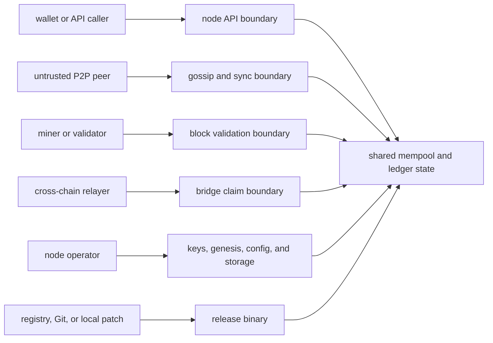

# Qanto Threat Model

Status: **FINAL AUDIT THREAT MODEL** for the effective 2026-08-09 candidate tree. Findings are linked to the completed workstream annexes; unresolved risks are not treated as mitigated by passing unit tests.

Expanded-mandate verdict: **NOT SAFE FOR PRIVATE TESTNET**

Twelve-workstream verdict: **NOT READY**

## Highest-value assets

1. supply and UTXO integrity;
2. deterministic canonical history and finality;
3. validator/miner and wallet key material;
4. bridge authenticity and replay state;
5. genesis and persisted-state integrity;
6. node availability and bounded resource use;
7. upgrade, governance, treasury, and contract authority;
8. operator observability and recovery evidence.

## Adversaries and required failure questions

| Adversary | Primary objectives | Required evidence before readiness |
|---|---|---|
| Unauthenticated API client | exhaust CPU/memory, trigger parser faults, obtain privileged data | request/response bounds, concurrency isolation, timeouts, auth/CORS behavior |
| Malicious P2P peer | crash, amplify work, poison peers, stall sync, relay invalid state | frame bounds, cheap-first validation, scoring/bans, queue bounds, partition recovery |
| Sybil/eclipsing swarm | monopolize peer table and isolate fork view | outbound diversity, connection identity, rotation, IP/ASN policy, bootstrap assumptions |
| Byzantine validator/miner | equivocate, forge rewards, manipulate timestamps/difficulty/order | quorum/finality proof, reward invariant, deterministic fork choice, evidence/slashing semantics |
| Cross-chain relayer attacker | forge or replay claims | source finality verification, proof authenticity, domain-separated message ID, atomic replay guard |
| Compromised node/operator | steal keys, corrupt state, expose unsafe APIs | encrypted non-exporting keys, permissions, recovery, corruption halt, least-privilege deployment |
| Dependency attacker | substitute consensus/crypto/network code | patch provenance, lockfile review, advisory scan, reproducible build/SBOM |
| Snapshot/bootstrap attacker | initialize a false state/history | chain ID, signed/canonical genesis, state root, chunk hashes, finality evidence |
| Cloud/provider outage | halt bootstrapping or validator majority | independent seeds, provider/geographic diversity, tested recovery |
| Future quantum attacker | forge exposed classical identities or decrypt recorded traffic | end-to-end algorithm inventory, hybrid binding, migration/versioning, current standards review |

## Launch-blocking conditions

Any confirmed path that permits unauthorized supply, incompatible finalized histories, trivial bridge forgery/replay, consensus-visible nondeterminism, or remotely exploitable unbounded resource exhaustion is treated as a launch blocker until fixed and independently re-tested.

## Trust boundaries and unsafe assumptions

The current architecture incorrectly or incompletely relies on these assumptions:

- an embedded ML-DSA public key is assumed to authorize an arbitrary native `sender` or textual `block.validator`; no key-to-identity binding proves that assumption;
- local SAGA/OMEGA/chain-load values are assumed to be identical across nodes even though they depend on floating arithmetic, local time/action order, local API traffic, and mutable telemetry;
- a DAG block is assumed safe to apply before canonical selection, although every branch mutates one global UTXO/balance state and no reorg journal exists;
- a relayer quorum is assumed to attest source-chain truth, but signatures authenticate relayers, not the claimed source receipt/finality; bridge claims are currently disabled;
- the startup sync path is assumed to obtain state, but it broadcasts the requester's own state and lacks authenticated checkpoints/resume;
- local compatibility forks and ignored audit warnings are assumed supportable until release, although stricter advisory and license policy remains red.

## Final risk register

| ID | Severity | Threat / abuse case | Evidence | Current control | Residual decision |
|---|---|---|---|---|---|
| TM-001 | SEV-1 | Attacker signs with its own ML-DSA key, names a victim as native `sender`, and spends the victim-owned UTXO. | `PQC-001`, `TX-001` | Signature and UTXO checks run, but neither binds the signing key to the sender/address. | **OPEN launch blocker** |
| TM-002 | SEV-1 | Attacker labels a block as a registered/staked validator while signing with an unrelated key. | `PQC-002`, `CNS-001` | Block ID and signature are verified against the key embedded by the attacker; unsafe automatic slashing was removed. | **OPEN launch blocker** |
| TM-003 | SEV-1 | Honest nodes accept different blocks because required reward or block-size limits depend on local mutable/floating state. | `CNS-003`, `CNS-006`, `SAGA-001`, `SAGA-002`, `ECO-003` | Exact reward/coinbase equality is enforced, but its input rule remains nondeterministic. | **OPEN launch blocker** |
| TM-004 | SEV-1 | Branch arrival order changes accepted spends and balances; a later error leaves partial state; reorg cannot restore canonical state. | `CNS-008`, `CNS-009`, `TX-005` | A mutex and intra-block duplicate-input planner reduce same-process races. There is no branch state, atomic batch, undo journal, or apply/unapply. | **OPEN launch blocker** |
| TM-005 | SEV-1 | Duplicate parents amplify fork weight, additional roots enter the DAG, and no active certificate provides finality. | `CNS-007`, `CNS-010`, `CNS-014` | Lexical tie ordering is deterministic for a well-formed set; unsafe automatic finality is disabled. | **OPEN launch blocker; no finality guarantee** |
| TM-006 | SEV-1 | Trailing-zero collisions or backend-specific QanHash outputs create conflicting IDs, Merkle commitments, or PoW results. | `CRY-002`, `POW-001`, `POW-002`, `POW-004` | CPU native-endian casts were replaced with explicit little-endian decode. No backend parity contract exists; CUDA does not compile. | **OPEN launch blocker** |
| TM-007 | SEV-1 | Ledger exceeds or misaccounts the sealed supply because live SAGA rewards bypass deterministic emission, fees count as issuance, cap updates only clamp a counter, and genesis/counter state disagree. | `ECO-003` through `ECO-007` | Sealed constants and compile-time allocation sum remain correct and unchanged. | **OPEN launch blocker** |
| TM-008 | SEV-1 if enabled | Forged or replayed cross-chain payload mints value without source-chain finality/proof verification. | `ZK-001` through `ZK-005` | SDK verifier fails closed and block validation rejects `BridgeClaim`. | **CONTAINED only by disabling bridge; unavailable as a feature** |
| TM-009 | SEV-1 | New node cannot authenticate/catch up state; hostile bootstrap peers or a Sybil swarm isolate its view. | `NET-003`, `NET-006`, `NET-007`, `NET-009` | Compound session keys and basic discovery exist. No authenticated resumable sync, IP/subnet diversity, ASN policy, peer rotation, or binding between the envelope key and libp2p identity is demonstrated. | **OPEN launch blocker** |
| TM-010 | SEV-1/2 | A valid 32 MiB block cannot traverse 2 MB gossip/4 MiB QDS; reconnect sleeps block the event loop; large peer inputs exhaust or stall shared resources. | `NET-004`, `NET-005`, `CNS-013` | Some frame/rate checks exist; no aligned envelope, nonblocking retry, resource bulkhead, or remote stress proof closes the risk. | **OPEN launch blocker** |
| TM-011 | SEV-2 | Unmaintained/unsound dependencies, yanked releases, local forks, or ambiguous first-party licensing undermine release integrity and patch response. | `WS1-002` through `WS1-006` | Ordinary cargo-audit reports zero non-ignored known vulnerabilities; cargo-deny bans/sources pass. | **OPEN: cargo-deny advisories and licenses fail** |
| TM-012 | SEV-1/2 | Users place value into incomplete contracts: QUSD lacks collateral/peg, swap logic is disabled, TGE lacks vesting, and governance/test coverage is incomplete. | `SC-001` through `SC-015` | Swap/unsupported paths fail closed; focused Faucet/QUSD tests pass. | **OPEN before any value-bearing deployment** |
| TM-013 | SEV-2 | Operator deploys an unproven topology with broken bootstrap/config/secrets/monitoring/backup assumptions and cannot recover safely. | `OPS-001` through `OPS-016` | Dedicated Docker/VPS assets and some Prometheus plumbing exist. Fresh-host, Kubernetes, restore, failover, and alert evidence is incomplete. | **OPEN operations blocker** |
| TM-014 | SEV-2 | Marketing or operator documentation causes unsafe reliance on features that are stubbed, disabled, simulated, or unmeasured. | `SPEC-001` through `SPEC-018` | Primary README/security/bridge/airdrop language was materially corrected. Remaining specification deltas are cataloged. | **OPEN governance/release gate** |

## High-impact attack paths

### Unauthorized native spend

1. Observe a victim address and an unspent output owned by that address.
2. Create a transaction whose `sender` is the victim but whose signature embeds the attacker's valid ML-DSA public key.
3. The node verifies the signature against that embedded key and separately compares the UTXO owner to the attacker-selected `sender`.
4. Because no derivation binds those values, both checks can pass without victim authorization.

Required remediation: version a domain-separated key/address scheme, bind every input owner and sender to the signing identity, migrate wallets/state, and add forgery plus cross-version vectors. This is a protocol migration, not a one-line signature check.

### Consensus split through local reward or size state

1. Two honest nodes share the same block/DAG set but receive different local API traffic, maintenance events, credentials, or candidate-production activity.
2. Their SAGA/OMEGA/chain-load state diverges.
3. Each recomputes a different mandatory reward or accepted block-size limit.
4. The same incoming block can be accepted by one and rejected by the other.

Required remediation: remove all local/floating inputs from block validity immediately, or replace them with a versioned, epoch-committed, integer-only state machine activated through an approved protocol proposal.

### Arrival-dependent state corruption

1. Competing DAG branches spend the same UTXO.
2. Each node validates against and mutates its one live state in arrival order before canonical choice.
3. The second branch is rejected or interpreted against different state depending on arrival.
4. A later fork-choice change has no undo/apply path; a persistence failure can also return after partial mutation.

Required remediation: branch-scoped state roots, an atomic database batch and undo journal, canonical apply/unapply, mempool reinsertion, restart recovery, and adversarial permutation/failure-injection tests.

### Bootstrap eclipse and stalled recovery

1. A new or partition-healed node connects to correlated/hostile peers.
2. Startup does not request an authenticated checkpoint and no IP/ASN diversity policy prevents view monopoly.
3. Oversized state/block data cannot fit every transport, while reconnect sleeps can stall the swarm event loop.
4. The node cannot prove it reached canonical state or recover promptly.

Required remediation: signed/finality-backed checkpoint manifests, bounded hashed chunks, resume and multi-peer verification, nonblocking retry with jitter, diversity quotas, peer rotation, and live chaos tests.

### Bridge forgery if containment is removed

1. Construct the deterministic proof-shaped SDK payload or another non-empty proof blob.
2. Obtain/forge the currently assumed relayer quorum without proving the source event/finality.
3. Reach the underlying claim mint handler.
4. Mint destination value without a verified source-chain state transition.

Current outcome: steps 2-4 are blocked because the SDK and node reject all bridge claims. The bridge must remain disabled until a real proof/light-client design, replay/nullifier state, canonical verification key, and independent audit are complete.

## Control effectiveness

| Control class | Effective controls | What they do not prove |
|---|---|---|
| Compile/test | Default workspace compiles; 207/207 zero-retry Rust tests pass with one skipped; 38/38 Hardhat tests pass | Multi-node convergence, state rollback, backend parity, remote DoS resistance, or economic soundness |
| Cryptographic containment | Real ML-DSA library verification; dormant PQ stub rejects; bridge SDK/node fail closed | Identity binding, ML-KEM session establishment, canonical bridge verification, constant-time certification |
| Consensus containment | Recomputed block IDs, fixed difficulty, exact reward distribution, deterministic lexical ties, unsafe finality/slashing/sharding disabled | Complete commitment domain, deterministic reward/size, validator eligibility, finality, canonical state |
| Supply chain | Cargo audit has zero non-ignored known vulnerabilities; npm audit has zero advisories | Cargo-deny advisories/licenses, maintained PQ dependencies, local-fork provenance, Solidity logic safety |
| Contract containment | Unsupported AMM paths fail closed; WQNTO/deployment hardening; focused tests | Stablecoin economics, TGE vesting, governance lifecycle, broad invariant/fuzz/SAST coverage |
| Documentation | Primary maturity and unavailable-feature claims were corrected | Independent validation or implementation of the documented future protocol |

## Verification boundaries

- Final Rust regression result: **207/207 runnable tests passed, 1 skipped, zero retries**.
- Final Solidity result: **38/38 tests passed**; measured coverage is **42.45% lines / 43.36% statements**.
- Cargo audit result: **zero non-ignored known vulnerabilities**, but strict mode rejects **five** maintenance/yank warnings.
- Cargo-deny result: **advisories and licenses fail**; bans and sources pass.
- All-target, no-default node, and CUDA build profiles fail with **5, 44, and 5 errors** respectively.
- Strict Clippy and full rustfmt gates fail.
- Slither, Mythril, Foundry/Echidna, Miri, Docker, Helm, kubectl, ShellCheck, and Terraform were unavailable; absence of findings from those tools is not evidence of safety.

## Mandatory closure evidence

Before private or public testnet readiness can be reconsidered, the project needs all of the following:

1. approved, versioned identity/address and block-commitment migrations with forgery and compatibility vectors;
2. deterministic integer-only monetary/block limits with persisted supply accounting and genesis migration;
3. branch-scoped atomic state, canonical reorg apply/unapply, restart recovery, and two-node permutation tests;
4. canonical root/parent rules and signed quorum finality with Byzantine partition tests;
5. one QanHash specification and cross-backend KAT/parity evidence, or one CPU-only canonical verifier with all other backends disabled;
6. authenticated resumable state sync, aligned transport limits, nonblocking reconnection, and eclipse/DoS simulations;
7. bridge kept disabled until a real source-finality/proof/replay design passes independent review;
8. a green release matrix: default, all-targets, supported feature profiles, strict Clippy, formatting, cargo-deny advisories/licenses, contract SAST/fuzz/coverage, and deployment smoke tests;
9. fresh-host deployment, secrets handling, monitoring/alerts, backup restore, failover, soak, and chaos evidence;
10. independent cryptographic, consensus, smart-contract, and economic audits after the protocol changes stabilize.

## Final threat decision

Multiple confirmed paths satisfy the launch-blocking conditions at the top of this document. Containment reduced blast radius—especially by disabling the bridge, unsafe finality/slashing/sharding, and unsupported contract behavior—but did not establish a safe distributed ledger.

- **NOT SAFE FOR PRIVATE TESTNET** under the expanded mandate.
- **NOT READY** for public testnet under the twelve workstreams.
- Mainnet review is premature until all mandatory closure evidence exists and the independent reviews find no unresolved launch blocker.
